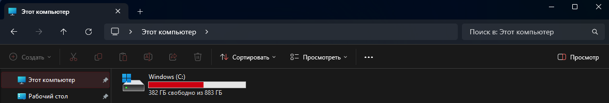
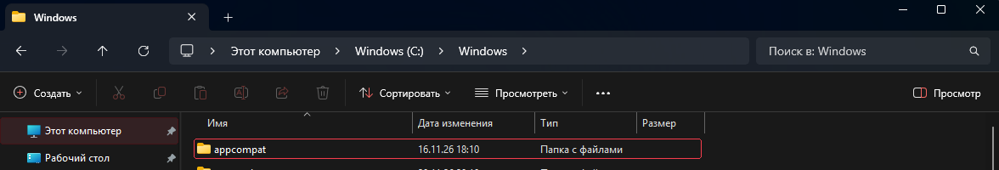
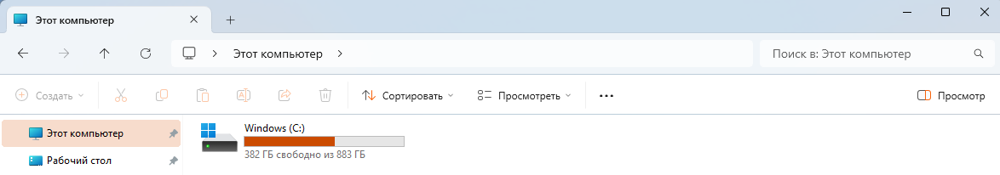
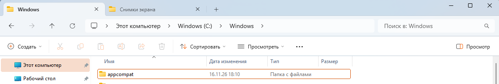
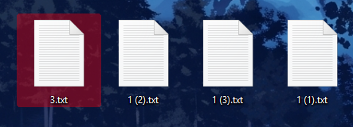
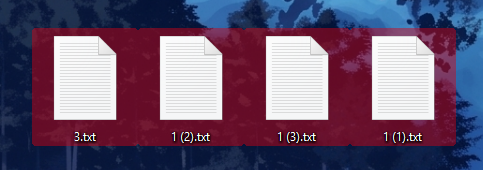
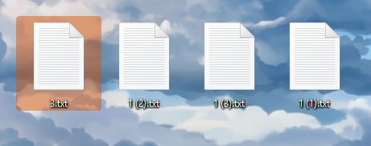
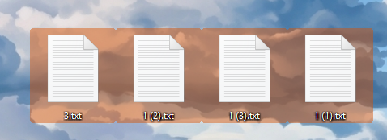

# AccentColorizer (Rust) - All-In-One

> High-performance, portable Windows accent colorizer unified into a single lightweight binary. Patches classic Win32 UI themes in-memory and recolors Windows 11 File Explorer SVG icons seamlessly in real time.

---

> [!WARNING]
> ### ⚠️ System Compatibility & Disclaimer
> This software has been developed, tuned, and tested **exclusively on the author's specific Windows 11 build**. 
> 
> **There is NO guarantee** that it will launch properly, look correct, or function stably on other Windows 11 builds (such as Insider Preview builds, Enterprise LTSC, or custom-stripped editions) or on **Windows 10**. 
> 
> Use this utility at your own risk and discretion.

---

## 🌟 Features & Architecture

* **Pure In-Memory Win32 Theming**:
  * Dynamically modifies visual style bitmaps in `uxtheme.dll` memory cache and system color tables (`SetSysColors`).
  * Seamlessly colorizes classic context menus, popup menus, buttons, edit boxes, trackbars, tabs, and common dialog controls.
  * Classic progress bar colorization is enabled by default.
  * Factory original bitmaps are cached in memory on launch, allowing instant lossless restoration when disabling features or reverting.

* **Windows 11 File Explorer SVG Icons (NTFS Junction Architecture)**:
  * Uses non-destructive NTFS Directory Junctions (`mklink /J`) pointing from Windows system folders to a local directory next to the executable.
  * Untouched factory original SVG packages are safely preserved inside `C:\Windows\SystemApps\...` with full `TrustedInstaller` ownership intact.
  * System file integrity checks (`sfc /scannow`, `DISM /Online /Cleanup-Image /RestoreHealth`) remain 100% clean and passing.
  * Zero code injection into `explorer.exe`, zero API hooking, zero third-party DLL dependencies.

* **8px Continuous Rounded Selection Plates**:
  * Replaces legacy sharp selection rectangles on the Desktop and in File Explorer with modern, continuous 8px rounded corners.
  * Hand-tuned opacity and border balance matching Windows 11:
    * **State 2 (Hover / Hot)**: 30% fill opacity with a continuous 1px border.
    * **State 3 (Selected)**: 45% fill opacity borderless.
    * **State 6 (Hot Selected)**: 70% fill opacity borderless.
    * **State 5 (Unfocused Selection)**: 20% fill opacity borderless.

* **Real-Time Dynamic Synchronization**:
  * Runs as a lightweight, zero-CPU resident background daemon.
  * Intercepts Windows messages (`WM_SETTINGCHANGE`, `WM_DWMCOLORIZATIONCOLORCHANGED`, `WM_THEMECHANGED`, `WM_WTSSESSION_CHANGE`) with a built-in debounce timer to immediately re-colorize UI whenever you change your Windows accent color or switch between Light and Dark mode.

* **Single Self-Contained Portable Binary**:
  * Compiled with `#![windows_subsystem = "windows"]` for completely silent execution (no flashing console windows or lingering `conhost.exe`).
  * Single `.exe` (~364 KB, stripped release build) with zero external dependencies (no runtime requirements, no config files needed).
  * Automatically requests Administrator privileges only when needed.

---

## 📸 Gallery

### File Explorer SVG Icons (Light & Dark Themes)





### UI Selection Plates & Context Menus





---

## 🚀 Quick Start & Usage

### 1. Default Background Daemon (Zero-Config)
Simply double-click `AccentColorizer.exe` or run it without arguments. It starts silently in the background, detects your active Windows accent color, applies all enhancements, and listens for future color/theme changes:

```cmd
AccentColorizer.exe
```

### 2. One-Click Autostart via Task Scheduler
To automatically run AccentColorizer at Windows startup for any user without UAC prompts:

```cmd
AccentColorizer.exe autostart
```

This single command:
1. Creates a shortcut (`AccentColorizer.lnk`) in the executable folder.
2. Registers a Windows Task Scheduler task named `AccentColorizer`:
   * **Trigger**: At logon of any user (`ONLOGON`).
   * **Startup Delay**: 30 seconds (`/DELAY 0000:30`), allowing Windows Explorer and desktop shell to initialize smoothly.
   * **Privileges**: Highest Administrator privileges (`/RL HIGHEST`), preventing UAC popups on boot.
   * **Power Settings**: Configured to run on laptops even on battery power (`AllowStartIfOnBatteries`) and will not stop if unplugged (`DontStopIfGoingOnBatteries`).

To uninstall and completely remove the autostart task and shortcut:
```cmd
AccentColorizer.exe uninstall
```

### 3. One-Time Manual Apply
If you do not want a background resident process and only want to apply the colors once and exit:

```cmd
AccentColorizer.exe apply
```

### 4. Complete Restoration & Revert
To undo all colorizations, restore pristine factory SVG icons, re-link TrustedInstaller ownership, and reset system colors:

```cmd
AccentColorizer.exe revert
```

---

## ⚙️ Command-Line Flags & Customization

You can pass customization flags directly to `autostart`, `apply`, or the background daemon. 

When passed to `autostart`, your chosen flags are automatically saved into both the scheduled task and the created `.lnk` shortcut.

| Flag | Description |
| :--- | :--- |
| `--no-progress` | Disable progress bar colorization (keeps default green/system bars) |
| `--no-win32` | Disable classic Win32 menu, button, and control colorization |
| `--no-svg` | Disable Windows 11 File Explorer SVG icon patching |
| `--no-explorer-selection` | Keep factory square blue selection plates in File Explorer |
| `--no-desktop-selection` | Keep factory square blue selection plates on the Desktop |
| `--color <#RRGGBB>` | Lock to a fixed custom accent color instead of following Windows personalization (e.g. `--color #0078D4`) |
| `--restart-explorer` | Automatically restart `explorer.exe` after applying or patching icons |
| `--no-restart-explorer` | Do not restart `explorer.exe` when reverting |
| `--foreground`, `-f` | Run daemon attached to the console with live debug logging |
| `--help`, `-h` | Display help and usage information |
| `--version`, `-v` | Display version information |

### Customization Examples

```cmd
# Autostart without progress bars and without desktop selection recoloring:
AccentColorizer.exe autostart --no-progress --no-desktop-selection

# Apply a custom static orange accent color immediately:
AccentColorizer.exe apply --color #FF5500

# Run in foreground with console logging for troubleshooting:
AccentColorizer.exe daemon --foreground
```

---

## 🛠️ Building from Source

### Prerequisites
* Rust toolchain (`cargo` and `rustc`).
* Windows 11 SDK (standard build environment).

### Build Command
```cmd
cd AccentColorizer-AllInOne
cargo build --release
```

The resulting standalone executable will be generated at:
`target/release/AccentColorizer.exe` (~364 KB).

---

## 👏 Special Thanks & Credits

This project builds upon ideas and previous implementations by the Windows theming community:
* Thanks to **[@krlvm](https://github.com/krlvm)** for the original [AccentColorizer](https://github.com/krlvm/AccentColorizer) and [AccentColorizer-E11](https://github.com/krlvm/AccentColorizer-E11) projects.
* Thanks to **[@mcdenis](https://github.com/mcdenis)** for the original [AccentApplicator](https://github.com/mcdenis/AccentApplicator).
* Thanks to **[@rounk-ctrl](https://github.com/rounk-ctrl)** for reviving and updating the codebase.
